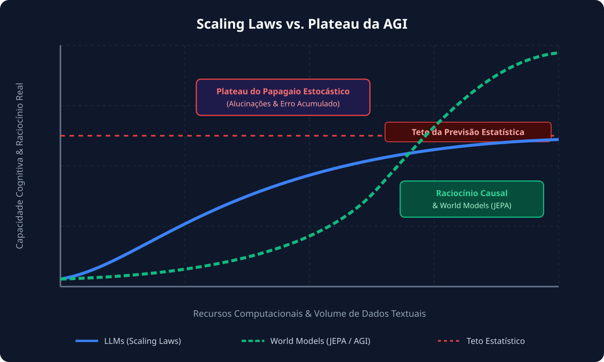
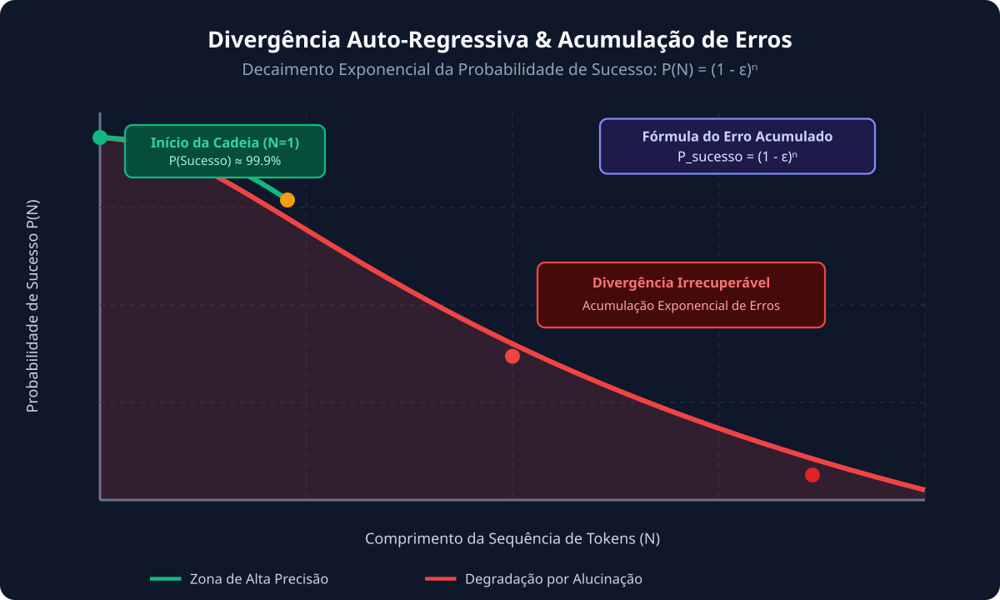
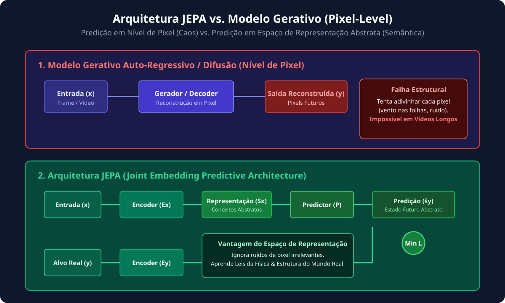

# 🧠 A Ilusão da Inteligência: O Que Realmente Separa os LLMs da AGI Real?

Por **Engenheiro de Dados & Pesquisador Especialista em IA**
_Data de Publicação: 10 de Outubro de 2026_

---

## 📌 Introdução: A Febre dos LLMs e a Falsa Promessa das Scaling Laws

Nos últimos anos, a indústria de tecnologia foi varrida por um entusiasmo sem precedentes em torno dos **Grandes Modelos de Linguagem (LLMs)**. O surgimento de sistemas capazes de sintetizar textos fluidos, responder perguntas complexas e escrever código funcional alimentou a narrativa de que estaríamos a poucos passos da **Inteligência Geral Artificial (AGI)**. A premissa central dessa corrente — defendida por diversos laboratórios comerciais — é simples: bastaria continuar escalando a quantidade de parâmetros, o volume de dados de treinamento e a infraestrutura de computação (**Scaling Laws**) para que a AGI emergisse naturalmente dos modelos preditivos [Fonte: OpenAI - Planning for AGI and Beyond].

No entanto, quando analisamos a questão sob a ótica estrita da engenharia de computação, da neurociência cognitiva e dos limites matemáticos da predição estatística, essa narrativa revela frestas profundas. A predição de tokens em sequências de texto, por mais escalada que seja, não constrói uma compreensão real da realidade física [Fonte: Yann LeCun - We Won't Reach AGI By Scaling Up LLMs].



Como ressaltado nas discussões de liderança em AGI, o avanço contínuo exige rigor metodológico, governança e alinhamento [Fonte: OpenAI - Planning for AGI and Beyond]. Contudo, a confusão entre **fluência sintática** e **raciocínio cognitivo** criou o que chamamos de _A Ilusão da Inteligência_. Para entender a distância que ainda nos separa de sistemas autônomos verdadeiramente inteligentes, precisamos desconstruir a mecânica interna dos LLMs atuais.

---

## 🎲 O Papagaio Estocástico: Previsão de Próximo Token e a Ilusão de Raciocínio

No coração de qualquer LLM moderno existe um único objetivo de otimização matematicamente simples: **maximizar a probabilidade do próximo token dado o histórico anterior**:

$$P(w_t \mid w_1, w_2, \dots, w_{t-1})$$

Apesar do grau de sofisticação dos mecanismos de atenção (_Self-Attention_), o modelo opera fundamentalmente como um **papagaio estocástico**. Ele mapeia superfícies estatísticas de alta dimensão no espaço de palavras, mas não possui um modelo mental interno sobre os conceitos que essas palavras representam [Fonte: Yann LeCun - Harvard CMSA Lecture].

### A Acumulação Exponencial de Erros (Divergência Auto-Regressiva)

Uma das maiores limitações intrínsecas da geração auto-regressiva é o fenômeno da **divergência estocástica**. Suponha que um LLM possua uma probabilidade de erro minúscula $\epsilon$ ao escolher o próximo token correto dentro de uma sequência de raciocínio lógico. À medida que o comprimento da sequência $N$ cresce, a probabilidade $P_{sucesso}$ de a cadeia inteira permanecer correta decai de forma exponencial [Fonte: Yann LeCun - Harvard CMSA Lecture]:

$$P_{sucesso}(N) = (1 - \epsilon)^N$$

Essa propriedade matemática explica o motivo pelo qual LLMs frequentemente "alucinam" ou perdem a coerência em tarefas de raciocínio de passos múltiplos: uma vez que o modelo gera um token fora da trajetória ideal, ele não possui um mecanismo interno intrínseco de autocorreção — ele continua prevendo tokens condicionados ao seu próprio erro anterior [Fonte: Yann LeCun - Harvard CMSA Lecture].



### O Paradoxo de Moravec na Era Moderna

O estado atual da IA evidencia de forma flagrante o **Paradoxo de Moravec**: tarefas intelectuais abstratas para humanos provaram ser relativamente simples para os computadores [Fonte: Yann LeCun - World Models: Enabling the Next AI Revolution]. Em contrapartida, habilidades sensório-motoras básicas que qualquer criança de 4 anos executa sem esforço — como perceber o espaço tridimensional ou entender a física intuitiva da gravidade — permanecem como desafios não resolvidos para a robótica e a IA [Fonte: Yann LeCun - World Models: Enabling the Next AI Revolution].

---

## 🏗️ Os Pilares Faltantes para a AGI

Para que um sistema de IA alcance o nível de adaptabilidade e autonomia característico de seres humanos, a arquitetura computacional precisa ir muito além de geradores de texto. A literatura científica aponta para quatro pilares fundamentais indispensáveis [Fonte: Yann LeCun - World Models: Enabling the Next AI Revolution]:

1. **Raciocínio Causal (Do-Calculus):** Compreensão explícita de causa e efeito em vez de meras correlações estatísticas [Fonte: Yann LeCun - We Won't Reach AGI By Scaling Up LLMs].
2. **Modelos de Mundo (World Models / JEPA):** Aprendizado de representações abstratas e físicas do ambiente em vez de predição em nível de pixel ou palavras [Fonte: Yann LeCun - Harvard CMSA Lecture].
3. **Aprendizado Contínuo (Continual Learning):** Memória persistente sem esquecimento catastrófico (_catastrophic forgetting_) [Fonte: Yann LeCun - World Models: Enabling the Next AI Revolution].
4. **Eficiência Energética:** Transição de mega-clusters de GPUs em escala de Gigawatts para a eficiência de ~20W do cérebro biológico [Fonte: OpenAI - Planning for AGI and Beyond].



---

## 📊 Tabela Comparativa Detalhada

| Dimensão Técnica            | LLMs Atuais (Predictive Text) 🎲                                             | Sistemas AGI Reais (World Models / JEPA) 🏗️                                                            |
| :-------------------------- | :--------------------------------------------------------------------------- | :----------------------------------------------------------------------------------------------------- |
| **Paradigma Principal**     | Previsão auto-regressiva de próximo token [Fonte: Yann LeCun - Harvard CMSA] | Predição em Espaço de Representação Abstrata (JEPA) [Fonte: Yann LeCun - ETH Zurich]                   |
| **Mecanismo de Inferência** | Propagação _feed-forward_ estática                                           | Minimização de Energia e Deliberação (System 2 / EBM) [Fonte: Yann LeCun - Harvard CMSA]               |
| **Análise de Causalidade**  | Correlação estatística e coocorrência                                        | Raciocínio Causal explícito e modelos contrafactuais ($do$-calculus)                                   |
| **Ancoragem (Grounding)**   | Ausente (dependência puramente textual) [Fonte: Yann LeCun - ETH Zurich]     | Ancoragem sensório-motora e física intuitiva (gravidade, massa, 3D) [Fonte: Yann LeCun - Harvard CMSA] |
| **Eficiência Energética**   | Elevadíssima (Gigawatts em Clusters)                                         | Altíssima eficiência energética (~20W biológicos)                                                      |

---

## 🚀 Caminhos Promissores para a Próxima Geração da IA

### Arquiteturas Neuro-Simbólicas

Fusão entre redes neurais profundas (percepção) e sistemas simbólicos baseados em lógica formal (raciocínio determinístico) para eliminar alucinações.

### Raciocínio do Tipo "Sistema 2" (Energy-Based Models)

Transição para inferências por otimização de energia. O sistema formula hipóteses, projeta sequências no seu Modelo de Mundo interno e avalia o custo antes de executar a ação [Fonte: Yann LeCun - ETH Zurich Lecture].

### Orquestração por Agentes e Padrões de Harness (RAG Avançado)

Integração de LLMs a ferramentas externas e bases de conhecimento dinâmicas através do **Gemini SDK** e pipelines RAG [Fonte: Integração do Agente Python com Gemini Notebook]:

```python
import os
from google import genai

client = genai.Client(api_key=os.getenv("GEMINI_API_KEY"))

def consultar_segundo_cerebro(notebook_id: str, pergunta: str):
    """
    Realiza consulta RAG no Gemini Notebook para extrair
    fatos fundamentados e eliminar alucinações.
    """
    response = client.notebooks.retrieve_relevant_chunks(
        name=f"notebooks/{notebook_id}",
        query=pergunta
    )
    return response.chunks

# Consulta fundamentada via Agente Python
chunks_verificados = consultar_segundo_cerebro(
    notebook_id="ee7b447d-3d45-41d4-a6ed-45bd6d722a29",
    pergunta="Quais são os pilares arquiteturais que diferenciam LLMs de Modelos de Mundo?"
)

🏁 Conclusão

A AGI real não surgirá da mera repetição de padrões textuais. Ela emergirá quando nossas máquinas forem capazes de compreender o mundo físico, prever as consequências de suas ações no espaço de abstração e aprender continuamente com a elegância e eficiência da própria natureza.
```
